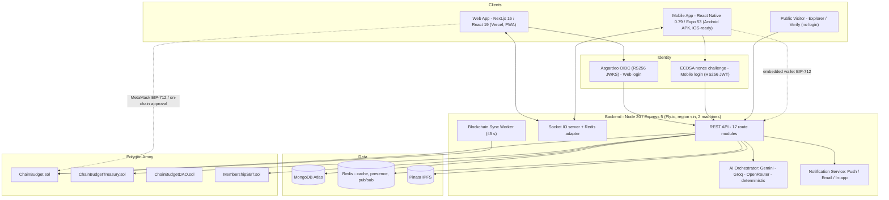
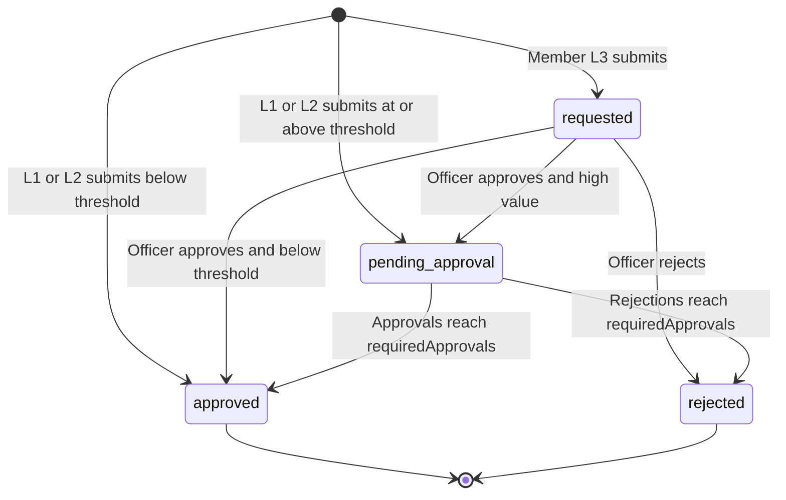
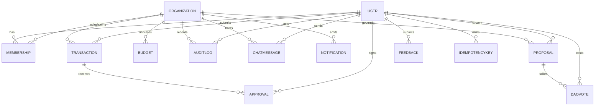
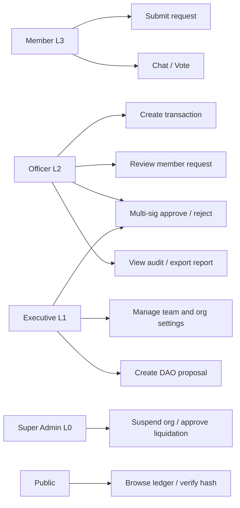
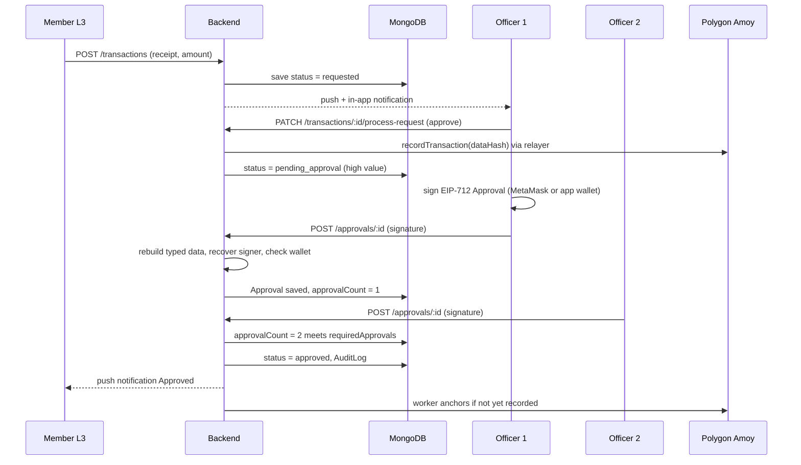
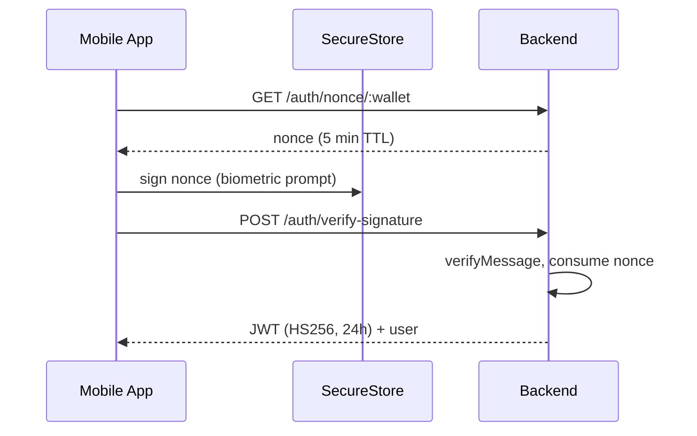

# Software Requirements Specification (SRS)

## ChainBudget — Blockchain-Powered Transparent Fund Management System

| Field | Value |
| :--- | :--- |
| **Document ID** | CB-SRS-2026-001 |
| **Version** | 1.0 (baseline derived from source code analysis) |
| **Date** | 2026-10-09 |
| **Project Type** | Capstone Project |
| **Authors** | Alfie Lynard Polacas & ChainBudget Engineering Team |
| **Standard** | Structured after IEEE Std 830-1998 / ISO/IEC/IEEE 29148 |
| **Code Baseline** | Git `main` @ `72a4bf3` (backend v1.0.0, web v0.1.0, mobile v1.1.15) |
| **Live Deployment** | API: `chainbudget-api.fly.dev` (Fly.io, Singapore) · Web: Vercel · Chain: Polygon Amoy testnet (chainId 80002) |

> [!NOTE]
> This SRS was reverse-engineered from the actual implementation (routes, models, contracts, screens, CI files and existing project documents). Requirements are marked **Implemented**, **Partial**, or **Planned**. Section 9 (Limitations) lists only issues that are evidenced in code or configuration.

---

## Table of Contents
1. [Introduction](#1-introduction)
2. [Overall Description](#2-overall-description)
3. [System Features & Functional Requirements](#3-system-features--functional-requirements)
4. [External Interface Requirements](#4-external-interface-requirements)
5. [Data Requirements](#5-data-requirements)
6. [Non-Functional Requirements](#6-non-functional-requirements)
7. [Smart Contract Specification](#7-smart-contract-specification)
8. [System Models](#8-system-models)
9. [Limitations & Known Issues](#9-limitations--known-issues)
10. [Future Enhancements](#10-future-enhancements)
11. [Appendices](#11-appendices)

---

## 1. Introduction

### 1.1 Purpose
This document specifies the functional and non-functional requirements of **ChainBudget**, a Web2 + Web3 hybrid platform that brings transparency, accountability and tamper-evident auditability to the management of shared funds. It is intended for the capstone panel, developers, testers, maintainers and future contributors.

### 1.2 Problem Statement
Small institutions (student organizations, barangays, homeowners' associations, cooperatives, NGOs, churches, sports clubs, startups, families and fundraising groups) manage shared money using spreadsheets, chat messages and paper receipts. This leads to:
- No tamper-proof record of who approved what and when.
- Single-person control over large expenditures.
- Difficulty for members/donors to verify how funds were used.
- Receipts and approvals scattered across informal channels.

### 1.3 Product Scope
ChainBudget provides:
1. **Role-based fund workflow** — Members submit requests; officers review; high-value items require **2-of-N cryptographic multi-signature** approval.
2. **Blockchain anchoring** — Each approved transaction's keccak256 data hash, amount and recipient are recorded on **Polygon Amoy** through a smart contract.
3. **Public transparency** — A public explorer and verification page let anyone verify a transaction by hash/ID without logging in (for non-private organizations).
4. **Collaboration** — Per-organization real-time chat, notifications (in-app/push/email) and DAO-style proposal voting.
5. **Intelligence** — AI receipt scanning, proposal risk analysis and cash-flow forecasting with deterministic fallbacks.
6. **Two clients** — A Next.js web dashboard and a React Native (Expo) Android/iOS app with an embedded, biometric-protected wallet.

**Out of scope (current baseline):** real bank/e-wallet payment rails, fiat↔crypto conversion, mainnet deployment, KYC, and accounting-standard double-entry bookkeeping.

### 1.4 Definitions, Acronyms, Abbreviations

| Term | Meaning |
| :--- | :--- |
| **SRS** | Software Requirements Specification |
| **RBAC** | Role-Based Access Control |
| **Multi-Sig** | Multi-signature approval (k-of-N signers) |
| **EIP-712** | Ethereum typed structured-data signing standard |
| **EIP-191** | `personal_sign` message signing standard |
| **SBT** | Soulbound Token — non-transferable ERC-721 membership token |
| **DAO** | Decentralized Autonomous Organization (governance voting) |
| **Asgardeo** | WSO2 cloud identity provider (OIDC/OAuth 2.0) used by the web app |
| **Amoy** | Polygon proof-of-stake test network (chainId 80002) |
| **POL / MATIC** | Native gas token of Polygon |
| **Relayer** | Backend-controlled wallet that pays gas on behalf of users |
| **IPFS / Pinata** | Decentralized file storage / pinning service for receipts |
| **TEE** | Trusted Execution Environment (Android Keystore / iOS Keychain) |
| **CSRF** | Cross-Site Request Forgery |
| **L0–L4** | Role levels (Section 2.3) |
| **PHP / ₱** | Philippine Peso (default currency) |

### 1.5 References
| # | Document / Source |
| :--- | :--- |
| 1 | `README.md` — Project overview |
| 2 | `docs/ENGINEERING_ROADMAP.md` — Architecture evolution blueprint |
| 3 | `security_assessment.md` — Post-hardening security architecture (v2.0) |
| 4 | `DEPLOYMENT_GUIDE.md`, `DEMO_SCRIPT.md`, `QUICK_SETUP.md`, `Mobile_Architecture_Plan.md` |
| 5 | `contracts/README.md` and Solidity sources in `contracts/contracts/` |
| 6 | `.github/workflows/ci.yml`, `.github/workflows/security.yml` |
| 7 | IEEE Std 830-1998; ISO/IEC/IEEE 29148:2018 |
| 8 | Philippine Data Privacy Act of 2012 (RA 10173) — referenced in mobile `DataPrivacyScreen` |

### 1.6 Document Overview
Sections 2–3 describe the product and its features; 4–5 the interfaces and data; 6–7 quality attributes and on-chain logic; 8 models; **9 limitations**; 10 roadmap; 11 appendices.

---

## 2. Overall Description

### 2.1 Product Perspective
ChainBudget is a four-tier, multi-client system.



### 2.2 Product Functions (Summary)
| # | Function Area | Web | Mobile |
| :--- | :--- | :---: | :---: |
| 1 | Authentication & wallet management | ✔ | ✔ |
| 2 | Multi-organization management & team roles | ✔ | ✔ |
| 3 | Transaction / request submission with receipts | ✔ | ✔ |
| 4 | Two-stage approval (officer review → multi-sig) | ✔ | ✔ |
| 5 | Budget allocation & overspend control | ✔ | ✔ |
| 6 | Blockchain anchoring, verification & escrow | ✔ | ✔ |
| 7 | Audit trail | ✔ | ✔ |
| 8 | Reports, charts & export | ✔ (PDF/CSV) | ✔ |
| 9 | Organization chat (real-time) | ✔ | ✔ |
| 10 | DAO governance (proposals & voting) | ✔ | ✔ |
| 11 | AI assistant (receipt scan, risk, forecast) | ✔ | ✔ |
| 12 | Notifications (in-app, push, email) | ✔ (in-app/email) | ✔ (all) |
| 13 | Public explorer & transaction verification | ✔ | ✔ |
| 14 | Platform administration (Super Admin) | ✔ | — |
| 15 | Device security (PIN, biometrics, anti-screenshot) | — | ✔ |
| 16 | QR scanner / receive / transfer utilities | — | ✔ |
| 17 | Feedback, help/FAQ, privacy notice | ✔ | ✔ |

### 2.3 User Classes and Characteristics

| Level | Role (label seen in code) | Characteristics & Permissions |
| :---: | :--- | :--- |
| **L0** | Platform Super Admin (`isSuperAdmin`) | Bypasses per-org role checks; suspends organizations; approves liquidation/subsidy; views platform stats. |
| **L1** | Executive Approver (e.g., Founder/President) | Full org control: edit org, invite/change/remove members, create transactions, approve/reject, treasury & emblem settings. |
| **L2** | Finance / Transaction Officer (e.g., Approver/Treasurer/Auditor) | Create transactions, review member requests, sign multi-sig approvals, view audit & export reports, submit liquidation. |
| **L3** | Member / Contributor | Submit funding **requests** (status `requested`), view approved ledger, chat, vote in DAO. |
| **L4** | Public Viewer | Read-only access to approved transactions and summaries. |
| **Anon** | Public visitor | Reads public (non-private) org ledgers and verifies hashes; read-only WebSocket. |

### 2.4 Operating Environment
| Component | Environment |
| :--- | :--- |
| Backend | Node.js 20 (Docker `node:20-alpine`, non-root user), Fly.io (1 vCPU / 1 GB, 2 machines, `sin`), health check `/api/health` every 15 s |
| Database | MongoDB Atlas (pool min 5 / max 50, IPv4 forced) |
| Cache / Pub-Sub | Redis (optional; fail-open to in-memory + MongoDB) |
| Web | Modern browsers; Next.js 16.2.9 (Turbopack), React 19.2.4, Tailwind CSS 4, PWA (`next-pwa`); MetaMask for external-wallet signing |
| Mobile | Android 8+ (Expo SDK 53, RN 0.79.6, package `com.chainbudget.app`); iOS bundle configured; EAS builds |
| Blockchain | Polygon Amoy testnet; Hardhat; OpenZeppelin 5.x |

### 2.5 Design and Implementation Constraints
- **C-1** Smart contracts are Solidity `^0.8.20` using OpenZeppelin `Ownable2Step`, `Pausable`, `ReentrancyGuard`, `EIP712`, `ECDSA`, `ERC721`.
- **C-2** Backend uses Express 5, Mongoose 9, ethers v6; all clients use ethers v6.
- **C-3** Web authentication is delegated to Asgardeo (OIDC); mobile uses wallet signature login.
- **C-4** Chain interaction is limited to **testnet**; public free RPC endpoints are used with rotation.
- **C-5** Sensitive secrets (`ENCRYPTION_SECRET`, `CSRF_SECRET`, `JWT_SECRET`) are mandatory at boot (fail-fast).
- **C-6** Currency defaults to PHP; all amounts are numeric (non-negative, minimum 1).

### 2.6 Assumptions and Dependencies
- Asgardeo tenant, MongoDB Atlas, Fly.io, Vercel, Pinata and (optionally) Redis, Gemini/Groq/OpenRouter and Expo Push services are available.
- The relayer wallet holds enough test POL (worker pauses when balance < 0.015 POL).
- At least **two** L1/L2 officers exist for any organization that handles high-value transactions (default `requiredApprovals = 2`).
- Users have a modern device/browser; approvers using the web have MetaMask or a linked wallet.

---

## 3. System Features & Functional Requirements

Priority: **H** = High, **M** = Medium, **L** = Low. Status: ✔ Implemented · ◐ Partial · ○ Planned.

### 3.1 Authentication & Wallet Management

| ID | Requirement | Pri | Status |
| :--- | :--- | :---: | :---: |
| FR-AUTH-01 | The web system shall authenticate users through Asgardeo OIDC and verify RS256 JWTs via JWKS (algorithm pinned, issuer/audience validated), falling back to the UserInfo endpoint for opaque tokens. | H | ✔ |
| FR-AUTH-02 | On first Asgardeo login the system shall auto-provision a `User` and generate an HD wallet whose private key and mnemonic are stored **AES-256-GCM (v2)** encrypted (`select:false`). | H | ✔ |
| FR-AUTH-03 | The mobile app shall generate a BIP-39 (12-word) / BIP-44 wallet on-device, storing the private key and mnemonic in hardware-backed SecureStore gated by biometrics; only the address/public key are sent to the backend. | H | ✔ |
| FR-AUTH-04 | Mobile login shall use a one-time 32-byte nonce (5-min TTL, single-use) signed by the wallet; the backend shall recover the signer with `ethers.verifyMessage` and issue an HS256 JWT (24 h). | H | ✔ |
| FR-AUTH-05 | Users shall be able to **link an external wallet** (e.g., MetaMask) by signing a link nonce; linked wallets are stored in `linkedWallets`. | H | ✔ |
| FR-AUTH-06 | Exporting wallet keys shall require a two-step re-authentication: `POST /auth/keys/challenge` (nonce) then `POST /auth/keys/export` with a wallet signature; exports are rate-limited and failures are audit-logged. | H | ✔ |
| FR-AUTH-07 | Users shall be able to restore a wallet from the 12-word phrase (mobile) and confirm backup (`hasBackedUpPhrase`). | M | ✔ |
| FR-AUTH-08 | Inactive users (`isActive:false`) shall be rejected at the auth middleware. | H | ✔ |
| FR-AUTH-09 | The system shall mint a non-transferable membership SBT for a user wallet on request (`/auth/mint-sbt`). | M | ◐ |
| FR-AUTH-10 | Sessions shall support web session cookie/`localStorage` token, automatic refresh before signing, and a "Session expired" modal on 401. | M | ✔ |

### 3.2 Organization & Team Management

| ID | Requirement | Pri | Status |
| :--- | :--- | :---: | :---: |
| FR-ORG-01 | Any authenticated user shall be able to create an organization of one of 10 types: `student_org, barangay, homeowners_association, ngo, cooperative, church, sports_club, startup, family, fundraising`. | H | ✔ |
| FR-ORG-02 | Organization settings shall include `highValueThreshold` (default ₱10,000), `requiredApprovals` (default 2), `isPrivate`, `logoUrl` (emblem), `subsidyAmount`, `contractAddress`. L1 only may edit. | H | ✔ |
| FR-ORG-03 | L1 shall invite a member by wallet/email identifier with a role level (1–4) and label; the invitee receives in-app, push and email notifications. | H | ✔ |
| FR-ORG-04 | L1 shall be able to update a member's role and remove a member (not themselves). | H | ✔ |
| FR-ORG-05 | A user may belong to multiple organizations; a UI organization selector/bottom-sheet shall switch the active org. | H | ✔ |
| FR-ORG-06 | Super Admin shall be able to list all organizations/users, view platform statistics and activity, and **suspend / re-activate** organizations. | M | ✔ (web) |
| FR-ORG-07 | Org admins (L≤2) shall submit a **liquidation**; Super Admin shall approve it, triggering an automated subsidy income transaction (default ₱50,000) and a symbolic on-chain transfer. | M | ✔ |
| FR-ORG-08 | Organizations may be marked private; private ledgers shall be hidden from public endpoints. | M | ✔ |

### 3.3 Transaction & Request Management

| ID | Requirement | Pri | Status |
| :--- | :--- | :---: | :---: |
| FR-TXN-01 | L1/L2 users shall create `income` or `expense` transactions with amount ≥ 1, description, category, reference number, notes, urgency, optional escrow flag and receipt (`documentUrl`, `documentHash`). | H | ✔ |
| FR-TXN-02 | L3 members shall create **requests** whose initial status is `requested` (Stage 1). | H | ✔ |
| FR-TXN-03 | For L1/L2 submissions the initial status shall be `approved` when `amount < highValueThreshold`, else `pending_approval`. | H | ✔ |
| FR-TXN-04 | Expense transactions with a `category` shall be validated against the organization's `Budget`: the category must exist and `amount + (approved + pending + requested spend)` must not exceed `allocated`. | H | ✔ |
| FR-TXN-05 | State-changing financial requests shall support an optional `x-idempotency-key`; duplicates return the cached 2xx response. | H | ✔ |
| FR-TXN-06 | On creation the system shall write an audit log, create an in-app notification, emit scoped Socket.IO events (`transaction_updated`, `new_notification`), and for `pending_approval` email L1 officers and push-notify L1/L2. | H | ✔ |
| FR-TXN-07 | The system shall list transactions per org with filters (`status`, `type`, date range/`range`), pagination (max 100/page) and role-aware visibility: L4 sees only `approved`; L3 sees `approved` and **own** `requested`; L1/L2/L0 see all. | H | ✔ |
| FR-TXN-08 | Each listed transaction shall include submitter, organization threshold info, `approvedBy[]`, `approvalCount` and `hasVoted` for the caller. | H | ✔ |
| FR-TXN-09 | Receipts may be attached after creation (`PATCH /:id/receipt`). | M | ✔ |
| FR-TXN-10 | A pending-count endpoint shall power approval badges on web and mobile. | M | ✔ |
| FR-TXN-11 | A manual `retry-sync` and `sync-onchain` shall allow re-anchoring of transactions not yet recorded on-chain. | M | ✔ |

### 3.4 Two-Stage Approval Workflow



| ID | Requirement | Pri | Status |
| :--- | :--- | :---: | :---: |
| FR-APR-01 | **Stage 1 — Officer Review:** L1/L2 (or Super Admin) shall approve or reject a `requested` item via `PATCH /transactions/:id/process-request`. Approval promotes it to `pending_approval` (high value) or `approved`; the system then records it on-chain using the requester's wallet as recipient. | H | ✔ |
| FR-APR-02 | **Stage 2 — Multi-Sig:** For `pending_approval` items, L1/L2 officers shall each sign an **EIP-712 `Approval` typed message** (`action, txId, amount, description, to, amountWei`) under domain `{name:"ChainBudget", version:"1"}`. | H | ✔ |
| FR-APR-03 | The backend shall rebuild the typed message **exclusively from server-side data** (never trusting client `amountWei`/`to`), recover the signer, and accept it only if the signer equals the officer's primary wallet **or any linked wallet**. | H | ✔ |
| FR-APR-04 | A user shall vote **once per transaction** (unique index `transaction+approver`); votes execute inside a MongoDB session/transaction. | H | ✔ |
| FR-APR-05 | When approvals ≥ `requiredApprovals` the status becomes `approved`; when rejections ≥ `requiredApprovals` it becomes `rejected`. `approvalCount` and `approvals[]` shall be persisted on the transaction. | H | ✔ |
| FR-APR-06 | The approval UI shall require a "receipt/proposal verified" confirmation before enabling Approve, show an overspend/low-budget warning, and show tabs *All Pending / Multi-Sig / Member Requests*. | M | ✔ |
| FR-APR-07 | The web shall detect MetaMask account mismatch and open an interactive guide modal; accounts equal to a linked wallet are accepted. | M | ✔ |
| FR-APR-08 | The mobile app shall provide swipeable approval cards, a biometric-gated confirm modal and an optimistic UI with rollback on failure. | M | ✔ |
| FR-APR-09 | When a threshold is met and the org has a `contractAddress`, the backend shall attempt **gasless relayer execution** via `executeWithSignatures` (disabled when `NODE_ENV=production`, see L-01). | M | ◐ |
| FR-APR-10 | Approvers/submitters shall receive push notifications when a transaction is approved/rejected. | M | ✔ |

### 3.5 Budget Management

| ID | Requirement | Pri | Status |
| :--- | :--- | :---: | :---: |
| FR-BUD-01 | L1/L2 shall create, edit and delete budget categories (`name`, `allocated ≥ 0`, `color`); names are unique per organization. | H | ✔ |
| FR-BUD-02 | The UI shall visualise allocated vs. spent per category (charts) and warn at ≥ 80% utilization. | M | ✔ |
| FR-BUD-03 | Overspend shall be blocked at creation (FR-TXN-04) and warned at approval. | H | ✔ |

### 3.6 Blockchain Anchoring, Verification & Escrow

| ID | Requirement | Pri | Status |
| :--- | :--- | :---: | :---: |
| FR-CHN-01 | For each non-request transaction the backend shall compute `keccak256(JSON payload)` (org, amount, type, description, submitter wallet, timestamp, document hash) and call `recordTransaction` on `ChainBudget.sol`, persisting `onChainTxId`, `blockchainTxHash`, `dataHash`, `isRecordedOnChain`. | H | ✔ |
| FR-CHN-02 | Chain failures shall **not** block the workflow; a background worker (45 s interval, batch of 10) shall re-anchor `approved` transactions that lack a hash, pausing when relayer balance < 0.015 POL. | H | ✔ |
| FR-CHN-03 | RPC access shall rotate across multiple endpoints (publicnode → polygon.technology → drpc) and re-initialize on error. | M | ✔ |
| FR-CHN-04 | Anyone shall verify a transaction by blockchain hash (`0x…`) or internal ID via the public verify endpoint/page, receiving `isVerified`, explorer link and receipt IPFS hash. | H | ✔ |
| FR-CHN-05 | **Escrow:** transactions flagged `isEscrow` shall lock funds on-chain and release only after **both** payer-side (owner/approver) and payee confirmation (direct, EIP-191 payee signature, or owner-recorded off-chain evidence). | M | ✔ |
| FR-CHN-06 | The system shall expose protocol/network status (contract address, RPC latency) to clients. | L | ✔ |
| FR-CHN-07 | Receipts shall be uploaded to IPFS via Pinata (CIDv1); on failure a local/data-URI fallback with `local_…` hash is returned. | M | ◐ |

### 3.7 Audit Trail
| ID | Requirement | Pri | Status |
| :--- | :--- | :---: | :---: |
| FR-AUD-01 | Every material action (`transaction.created/approved/rejected/request_approved/request_rejected/escrow_*`, key-export failures, member changes) shall create an `AuditLog` with actor, actor wallet, action, target, details, optional chain hash. | H | ✔ |
| FR-AUD-02 | L1/L2 shall view the paginated/filtered audit log; entries link to Polygonscan when a hash exists. | H | ✔ |
| FR-AUD-03 | Audit entries shall record the **actual signing wallet** used for approvals (primary or linked). | M | ✔ |

### 3.8 Reporting & Analytics
| ID | Requirement | Pri | Status |
| :--- | :--- | :---: | :---: |
| FR-RPT-01 | The system shall provide a summary: total income, total expenses, balance, pending approvals, approved and on-chain counts, and a **6-month cash-flow** series (approved transactions). | H | ✔ |
| FR-RPT-02 | The system shall provide expense breakdown by category. | H | ✔ |
| FR-RPT-03 | L1/L2 shall export approved transactions (JSON API) and the web shall generate **PDF/CSV** reports (jsPDF + autotable). | M | ✔ |
| FR-RPT-04 | Dashboards shall show KPI cards, charts (Recharts / native charts), skeleton loaders and animated counters. | M | ✔ |

### 3.9 Organization Chat (Real-Time)
| ID | Requirement | Pri | Status |
| :--- | :--- | :---: | :---: |
| FR-CHT-01 | Each organization has a chat room; members send text/image/system messages (≤ 2000 chars) with optimistic UI and a client-generated `clientMessageId` that guarantees idempotent delivery. | H | ✔ |
| FR-CHT-02 | Features: reply-to, emoji reactions, delivered/seen receipts, pin/unpin (L≤3), delete (own message, or any by L1), search, cursor pagination (≤100/page), pinned list, unread/conversation inbox. | H | ✔ |
| FR-CHT-03 | Real-time events: `new_org_message`, `org_message_reacted`, `org_messages_seen`, `org_message_delivered`, `org_message_pinned`, `org_message_deleted`, `org_online_users`. | H | ✔ |
| FR-CHT-04 | Presence shall be tracked cluster-wide (Redis) with in-memory fallback; online users appear as green indicators. | M | ✔ |
| FR-CHT-05 | Recent messages shall be cached in Redis sorted sets (7-day TTL) for fast bootstrap and fall back to MongoDB. | M | ✔ |
| FR-CHT-06 | Mobile shall provide chat info (members/media), push notification for mentions, and an unsent-message retry state. | M | ◐ |

### 3.10 DAO Governance
| ID | Requirement | Pri | Status |
| :--- | :--- | :---: | :---: |
| FR-DAO-01 | L1/L2 shall create a proposal (title ≤ 500, description ≤ 5000, amount, duration default 7 days) hashed with SHA-256; all members are notified (in-app, push, email). | H | ✔ |
| FR-DAO-02 | Each active member may cast **one** yes/no vote per proposal (unique index); votes broadcast `dao_vote_updated`. | H | ✔ |
| FR-DAO-03 | After `endTime`, effective status resolves to `passed` if yes > no, else `rejected`. | M | ✔ |
| FR-DAO-04 | L1/L2 may **execute** a proposal that passed (status → `executed`). | M | ◐ (status only; no fund transfer) |
| FR-DAO-05 | AI risk analysis (1–10) shall be available when drafting a proposal. | M | ✔ |

### 3.11 AI Assistance
| ID | Requirement | Pri | Status |
| :--- | :--- | :---: | :---: |
| FR-AI-01 | **Receipt scan:** upload ≤ 5 MB image; AI extracts merchant, total, date and suggested category (JSON) to pre-fill forms. | M | ✔ |
| FR-AI-02 | **Proposal analysis:** returns summary, risk score (1–10) and reason; falls back to a deterministic treasury-ratio engine. | M | ✔ |
| FR-AI-03 | **Forecast:** a CFO-style 2-paragraph forecast + 3 insights from transactions/budgets; deterministic fallback guarantees a response. | M | ✔ |
| FR-AI-04 | Provider chain shall be Gemini (multi-model fallback) → Groq → OpenRouter → deterministic, with prompt-input sanitization and robust JSON parsing. | M | ✔ |

### 3.12 Notifications
| ID | Requirement | Pri | Status |
| :--- | :--- | :---: | :---: |
| FR-NTF-01 | In-app notifications (persisted) with types `urgent, blockchain, system, info`, per-user `readBy`, mark-read and read-all; real-time `new_notification` events. | H | ✔ |
| FR-NTF-02 | Expo push notifications in 100-message chunks with automatic pruning of `DeviceNotRegistered` tokens; deep links via `data.screen`. | H | ✔ |
| FR-NTF-03 | Email notifications (HTML) for invitations, high-value approvals and DAO proposals. | M | ✔ |
| FR-NTF-04 | Users control preferences: `email, push, daoProposals, approvals, transactions, chatMentions, securityAlerts`. | M | ✔ |

### 3.13 Public Transparency
| ID | Requirement | Pri | Status |
| :--- | :--- | :---: | :---: |
| FR-PUB-01 | Unauthenticated users shall browse a directory of public organizations, their approved ledger and budget summary, and a global public feed. | H | ✔ |
| FR-PUB-02 | Public data shall exclude private organizations and sensitive fields. | H | ✔ |
| FR-PUB-03 | QR codes/links shall open the verification report (mobile `VerifyTransaction`/`VerificationReport`; web `/verify`). | M | ✔ |

### 3.14 Mobile-Specific Features
| ID | Requirement | Pri | Status |
| :--- | :--- | :---: | :---: |
| FR-MOB-01 | **App Lock:** 6-digit PIN (hashed) + biometric fallback + auto-lock timeout (`immediately/1m/5m/15m`). | H | ✔ |
| FR-MOB-02 | Recovery-phrase screen shall block screenshots/screen recording. | H | ✔ |
| FR-MOB-03 | QR scanner (camera) for wallet addresses/receipts; Receive (QR address) and Transfer utilities. | M | ✔ |
| FR-MOB-04 | Offline banner, response caching and socket reconnect handling. | M | ◐ |
| FR-MOB-05 | Theme selector (light/dark/system), haptic feedback, animated skeleton loaders, success celebration modals. | L | ✔ |
| FR-MOB-06 | In-app Feedback form (bug/suggestion/usability/general, 1–5 rating, screenshot, device info) stored as `Feedback`. | L | ✔ |
| FR-MOB-07 | Help/FAQ, About, Data-Privacy (RA 10173) and Network Status screens. | L | ✔ |

### 3.15 Web-Specific Features
| ID | Requirement | Pri | Status |
| :--- | :--- | :---: | :---: |
| FR-WEB-01 | Landing page, Help, Tutorials (video), Privacy page, interactive onboarding tour (react-joyride) and PWA install prompt. | M | ✔ |
| FR-WEB-02 | Dashboard modules: Dashboard, Transactions, Approvals, Budget, Treasury, Reports, Audit, Team, DAO, Chat, Settings. | H | ✔ |
| FR-WEB-03 | Settings: profile, Web3 keys/backup, notification preferences, linked wallets, org emblem rebrand, liquidation approvals (Super Admin). | M | ✔ |
| FR-WEB-04 | Admin console (`/admin`): platform stats, org directory, suspend/activate, activity feed, user list. | M | ✔ |
| FR-WEB-05 | All modals shall render through a React Portal so they are viewport-centered irrespective of ancestor CSS transforms. | L | ✔ |
| FR-WEB-06 | Cookie/privacy banner and CSP/HSTS security headers. | M | ✔ |

---

## 4. External Interface Requirements

### 4.1 User Interfaces
- **Web:** Responsive Tailwind-based dashboard with sidebar layout, dark glass-morphism theme, toasts (react-hot-toast), confetti on success, skeleton loaders, and forms validated with react-hook-form + zod.
- **Mobile:** 38 screens organized with React Navigation 7 (bottom tabs + native stack), NativeWind styling, Lottie animations, Inter font, bottom sheets and swipe gestures.
- **Accessibility/Localization:** English UI, Philippine Peso formatting; no i18n framework (see L-17).

### 4.2 Hardware Interfaces
Mobile: camera (QR/receipt), biometric sensor, vibration/haptics, secure hardware keystore, network state.

### 4.3 Software Interfaces
| Interface | Protocol / Library | Purpose |
| :--- | :--- | :--- |
| MongoDB Atlas | Mongoose 9 | Primary data store |
| Redis | ioredis 6, `@socket.io/redis-adapter` | Cache, presence, multi-node sockets |
| Asgardeo | OIDC / OAuth 2.0, JWKS | Web identity |
| Polygon Amoy RPC | JSON-RPC via ethers v6 | Contract reads/writes |
| Pinata | REST (`pinFileToIPFS`) | Receipt storage |
| Google Gemini / Groq / OpenRouter | REST / `@google/genai` | AI features |
| Expo Push | REST (`exp.host`) | Mobile push |
| Email provider | Nodemailer (SMTP; README references Resend) | Transactional email |
| MetaMask | EIP-1193, EIP-712 `signTypedData` | Web signing |

### 4.4 Communication Interfaces
- **REST/JSON over HTTPS** (`/api/*`) with `Authorization: Bearer <JWT>`, `X-CSRF-Token` for state-changing non-auth calls, optional `X-Idempotency-Key`.
- **WebSocket (Socket.IO 4.8)** with polling+websocket transports. Rooms: `org:<id>`, `user:<id>`. Client → server events: `authenticate`, `join_org`, `leave_org`, `get_org_online`. Server → client events: `authenticated`, `transaction_updated`, `new_notification`, `dao_vote_updated`, chat events (FR-CHT-03).
- Full endpoint catalog: Appendix A.

---

## 5. Data Requirements

### 5.1 Logical Data Model



### 5.2 Data Dictionary (key collections)

| Collection | Key Fields | Notes |
| :--- | :--- | :--- |
| **User** | `walletAddress` (unique, lowercase), `publicKey`, `encryptedPrivateKey` & `encryptedMnemonic` (`select:false`), `walletType` (`embedded_bip44 / external_metamask / external_walletconnect / asgardeo_generated`), `asgardeoId`, `email` (unique), `linkedWallets[]`, `isSuperAdmin`, `memberships[]` (`organization, roleLevel 1–4, roleLabel, isActive, hasSBT, sbtTokenId`), `nonce/nonceExpiresAt`, `keyExportNonce*`, `keyExportCount`, `hasBackedUpPhrase`, `pushTokens[]`, `notificationPreferences` | Helper `getRoleInOrg(orgId)` |
| **Organization** | `name`, `type` (10 enums), `description`, `logoUrl`, `highValueThreshold` (def 10000), `requiredApprovals` (def 2), `contractAddress`, `liquidationStatus (none/pending/approved)`, `subsidyAmount`, `isActive`, `isPrivate`, `createdBy` | Indexes on public directory & creator |
| **Transaction** | `organization`, `submittedBy`, `type`, `amount ≥ 0`, `currency` (PHP), `description ≤ 2000`, `category`, `referenceNumber`, `documentUrl`, `documentHash`, `status` (`requested / pending_approval / approved / rejected / cancelled`), `urgency`, `isHighValue`, `approvalCount`, `approvals[]`, `executed`, `isEscrow`, `escrowStatus (none/locked/released)`, `payerApproved`, `payeeApproved`, `onChainTxId`, `blockchainTxHash`, `dataHash`, `isRecordedOnChain`, `budgetCategory`, `notes` | Index `(organization, status, createdAt)` |
| **Approval** | `transaction`, `organization`, `approver`, `action (approved/rejected)`, `comment`, `walletAddress`, `digitalSignature`, `blockchainTxHash` | **Unique** `(transaction, approver)` |
| **Budget** | `organization`, `name`, `allocated`, `color` | **Unique** `(organization, name)` |
| **AuditLog** | `organization`, `actor`, `actorWallet`, `action`, `targetType`, `targetId`, `details`, `ipAddress`, `blockchainTxHash`, `onChainTxId` | Indexed by org/actor + time |
| **ChatMessage** | `organization`, `sender`, `content ≤ 2000`, `messageType`, `roleLevel/roleLabel`, `isPinned`, `reactions[]`, `seenBy[]`, `deliveredTo[]`, `replyTo`, `clientMessageId` | **Unique sparse** `(organization, clientMessageId)` |
| **Notification** | `organization`, `title`, `message`, `type`, `recipientUser` (null = all org), `readBy[]` | 5 compound indexes |
| **Proposal / DaoVote** | Proposal: `title`, `description`, `amount`, `organization`, `creator`, `status (active/passed/rejected/executed)`, `blockchainProposalId`, `dataHash`, `durationSeconds`, `endTime`; DaoVote: `proposal`, `voter`, `support` | One vote per voter per proposal |
| **Feedback** | `user`, `organization`, `type`, `title`, `message`, `rating 1–5`, `screenshotUrl`, `deviceInfo`, `status` | |
| **IdempotencyKey** | `key`, `user`, `path`, `responseStatus`, `responseBody` | Replays cached 2xx |

### 5.3 Data Retention & Protection
- Private keys/mnemonics are never returned except via the re-authenticated export flow.
- On-chain data are **hashes and metadata only**; descriptions and personal data remain off-chain.
- Redis chat cache TTL = 7 days; sanitizes large data-URI avatars before caching.
- Data-privacy notice for RA 10173 is provided in-app (mobile).

---

## 6. Non-Functional Requirements

### 6.1 Security (NFR-SEC)
| ID | Requirement | Status |
| :--- | :--- | :---: |
| NFR-SEC-01 | Transport: HTTPS only (Fly `force_https`), HSTS, CSP, `X-Frame-Options: DENY`, `nosniff`, Referrer-Policy, Permissions-Policy. | ✔ |
| NFR-SEC-02 | AuthN: RS256 JWKS (web) and HS256 wallet-challenge JWT (mobile); nonces single-use with 5-min TTL. | ✔ |
| NFR-SEC-03 | AuthZ: 5-level RBAC enforced per organization via `requireRole` and in-route checks; privilege-escalation attempts logged. | ✔ |
| NFR-SEC-04 | Stateless CSRF: HMAC-SHA256 tokens (1 h expiry, constant-time verify, rotated each request) for POST/PUT/PATCH/DELETE outside `/auth`. | ✔ |
| NFR-SEC-05 | Rate limiting: nonce 5/min, signature verify 10/min, general 500/min, key export 30 per 15 min per user. | ✔ |
| NFR-SEC-06 | NoSQL-injection protection by recursive `$`/`.` key stripping on body, params and query. | ✔ |
| NFR-SEC-07 | Secrets at rest: AES-256-GCM v2 (`v2:iv:tag:ciphertext`) with legacy CBC decrypt support; `ENCRYPTION_SECRET`, `CSRF_SECRET` (≥ 32 chars), `JWT_SECRET` validated at boot. | ✔ |
| NFR-SEC-08 | Signature integrity: EIP-712 messages reconstructed from server data; duplicate approvals blocked by DB uniqueness and transaction sessions. | ✔ |
| NFR-SEC-09 | File upload: authenticated, MIME whitelist (JPEG/PNG/WebP/PDF), 5 MB cap, sanitized filenames. | ✔ |
| NFR-SEC-10 | Production errors are generic; stack traces never returned. CORS strict origin whitelist. | ✔ |
| NFR-SEC-11 | Container runs as non-root; CI includes Gitleaks, CodeQL (`security-extended`) and `npm audit`. | ✔ |
| NFR-SEC-12 | Mobile: hardware-backed storage, biometric gating, no sensitive logging, app lock, screenshot prevention. | ✔ |

### 6.2 Performance & Scalability (NFR-PERF)
| ID | Requirement | Status |
| :--- | :--- | :---: |
| NFR-PERF-01 | Chat bootstrap shall be served from Redis sorted-set cache (target < 2 ms cache read) with MongoDB fallback. | ✔ |
| NFR-PERF-02 | The API shall sustain 500 req/min/IP and concurrency soft/hard limits of 200/250 per instance. | ✔ |
| NFR-PERF-03 | Compound indexes shall exist for all hot queries (org+status+date, chat pagination, notifications, audit). | ✔ |
| NFR-PERF-04 | Horizontal scale: Socket.IO Redis adapter allows multiple instances (2 machines deployed). | ✔ |
| NFR-PERF-05 | Chain calls time out at 60 s and never block the user request path for correctness. | ✔ |

### 6.3 Reliability & Availability (NFR-REL)
- Health endpoint `/api/health`; Fly health checks (15 s); `min_machines_running = 1`, auto start/stop.
- Fail-open design for Redis; AI deterministic fallbacks guarantee 100% response; blockchain sync worker self-heals unanchored transactions.
- MongoDB sessions provide atomicity for approvals.

### 6.4 Usability (NFR-USE)
- Optimistic UI for chat and approvals; skeleton loaders; toast feedback; guided onboarding tour; interactive wallet-mismatch guide; theme support; haptics on mobile.

### 6.5 Maintainability & Portability (NFR-MNT)
- Modular route/service/model layout; typed frontends (TypeScript); CI type-check + build; documented architecture roadmap (monolith → Redis → microservices).
- Dockerized backend; platform-agnostic Node app; Expo/EAS for mobile builds.

### 6.6 Legal & Compliance (NFR-LEG)
- Aligned to Philippine Data Privacy Act (RA 10173) and Cybercrime Prevention Act (RA 10175) via in-app notice. Security doc claims OWASP Top-10 ≈ 90%, MASVS L1 ≈ 95% (self-assessed, not independently audited).

---

## 7. Smart Contract Specification

| Contract | Role | Key Mechanics |
| :--- | :--- | :--- |
| **ChainBudget.sol** | Transaction ledger + vault + escrow | `recordTransaction(dataHash, amount, to, isHighValue, isEscrow)` (**onlyOwner** = backend relayer); high-value items need `requiredApprovals` unique `isApprover` approvals via `submitApproval`; `executeTransaction`; escrow via `releaseEscrow`, `releaseEscrowWithPayeeSignature` (EIP-191 over `address(this), chainid, txId, amount, to, "ESCROW_RELEASE"`), `recordOffchainPayeeConfirmation`; `totalLockedEscrow` segregates funds; `pause/unpause`; approver management. |
| **ChainBudgetTreasury.sol** | Gasless multi-sig execution | `executeWithSignatures(action, txId, amount, amountWei, description, to, signatures[])` verifies EIP-712 signatures, de-duplicates signers, requires `validSignatureCount ≥ requiredApprovals`, marks `executedTransactions[txId]` (replay protection), then transfers value. |
| **ChainBudgetDAO.sol** | On-chain governance | Member whitelist, `createProposal`, `castVote` (1 member = 1 vote, time-bound), `executeProposal`, `cancelProposal`, `setMinQuorum`. |
| **MembershipSBT.sol** | Soulbound membership | ERC-721 where `_update` blocks wallet-to-wallet transfers (mint/burn only); `mintMembership(to, orgId)`, `revokeMembership`, `isMemberOf`; on-chain SVG metadata. |

Security patterns: `Ownable2Step`, `ReentrancyGuard`, CEI ordering, `Pausable`, zero-address/zero-amount checks, indexed events, Solidity ≥ 0.8.20 overflow protection. Automated contract tests: `contracts/test/ChainBudget.test.js`.

---

## 8. System Models

### 8.1 Use-Case Overview


### 8.2 Sequence — Member Request to Executed Approval


### 8.3 Sequence — Mobile Wallet Login


---

## 9. Limitations & Known Issues

> [!IMPORTANT]
> These limitations are evidenced in source code, configuration or project documents. They are presented transparently for the capstone defense and future work. Severity: 🔴 High · 🟡 Medium · 🟢 Low.

### 9.1 Functional & Architectural Limitations

| ID | Sev | Limitation | Evidence / Impact |
| :--- | :---: | :--- | :--- |
| **L-01** | 🔴 | **Amounts are symbolic; no real money movement.** On-chain `amount` is the raw PHP integer; there is no PHP↔MATIC conversion or bank/e-wallet integration. The Treasury relayer execution is deliberately **blocked when `NODE_ENV=production`**. ChainBudget is an accountability/transparency ledger, not a payment processor. | `blockchain.js` CRIT-5 comment; `approvals.js` production guard |
| **L-02** | 🔴 | **Trusted backend relayer.** `recordTransaction` is `onlyOwner`; the backend wallet writes all records, so an on-chain record proves *what the server recorded*, not independent user intent. Off-chain DB is the source of truth. | `ChainBudget.sol`; blockchain failures are swallowed so workflows continue |
| **L-03** | 🟡 | **Single global contract.** `blockchain.js` uses one `CONTRACT_ADDRESS`; `Organization.contractAddress` exists but is not used for per-org recording. On-chain approver set is not auto-synced with DB roles (changes in roles do not update `isApprover`). | Multi-tenant isolation is application-level only |
| **L-04** | 🟡 | **No maker-checker (segregation of duties) enforcement.** The approval route does not prevent the submitter of a high-value transaction (if L1/L2) from also being one of the approvers. | `approvals.js` has no `submittedBy ≠ approver` check |
| **L-05** | 🟡 | **Low-value path bypasses multi-sig.** Items below threshold are auto-approved when created by L1/L2 or approved by a single officer when requested by L3. | `transactions.js` status logic |
| **L-06** | 🟡 | **DAO is off-chain in practice.** Votes/tallies live in MongoDB; the on-chain DAO contract is not wired into the voting route; no quorum on the backend; any active member (including L4 viewers) may vote; "execute" only changes status and does not disburse funds. | `dao.js` ("TBD in future iterations"); `/sync` references `proposal.proposer`, a field that does not exist in the schema (`creator`) — latent bug |
| **L-07** | 🟡 | **Custodial web wallets.** Asgardeo-provisioned wallets keep an encrypted private key on the server (decryptable by the backend secret). Only the mobile wallet is truly non-custodial. | `User.encryptedPrivateKey`, `/auth/keys/export` |
| **L-08** | 🟡 | **Wallet-mapping friction.** Approvers must sign with their primary or a *linked* wallet; otherwise a mismatch occurs (addressed by linked-wallet support, but linking is a manual step). | Resolved partially in `approvals/page.tsx` & `approvals.js` |
| **L-09** | 🟡 | **Escrow has no timeout/refund path** and depends on the payee being a wallet holder or owner-recorded off-chain evidence. | `security_assessment.md` GAP-13 |
| **L-10** | 🟡 | **Chain anchoring is best-effort & testnet-bound.** Reliance on free public RPCs (rate-limit incidents such as Tenderly 429), a single relayer wallet needing faucet POL (< 0.015 POL halts sync), and Polygon Amoy testnet (may reset/deprecate). No mainnet deployment. | `blockchainSyncWorker.js`, `blockchain.js` |
| **L-11** | 🟡 | **Receipt storage fallback is ephemeral.** If Pinata fails, files go to container disk (lost on redeploy) or are inlined as base64 data URIs (≤1.5 MB images stored in DB); such `local_…` hashes are not verifiable on IPFS. | `upload.js` |
| **L-12** | 🟡 | **AI features depend on third-party LLMs on free/low tiers.** Output is non-deterministic and may be inaccurate; receipt images leave the system boundary (privacy); model names/availability can change. Deterministic fallback is generic. | `aiProviders.js` |
| **L-13** | 🟢 | **Reporting is basic.** Summaries use only `approved` transactions, fixed 6-month window, JSON export (PDF/CSV generated client-side). No double-entry bookkeeping, tax or audit-standard reports. | `reports.js` |
| **L-14** | 🟢 | **Mobile offline support is read-cache only.** Banner and caching exist; no evidence of an offline write queue — transactions/approvals need connectivity. | `OfflineBanner`, `cache.ts` |
| **L-15** | 🟢 | **Android-focused delivery.** Build scripts target Android APK (EAS profiles); iOS config exists but no evidence of store release. No tablet/desktop app. | `package.json` scripts |
| **L-16** | 🟢 | **Role naming inconsistency.** Chat labels (L1 "President", L2 "Auditor", L3 "Treasurer") differ from the SRS/UI roles (L2 Finance/Approver, L3 Member). | `chat.js` ~line 412 |
| **L-17** | 🟢 | **Single language/currency.** English UI, PHP default; no i18n; Filipino/Cebuano localization absent. | Codebase-wide |
| **L-18** | 🟢 | **Web admin only.** Platform administration is not available in the mobile app. | Mobile screens list |

### 9.2 Security Limitations (Deferred / Residual)

| ID | Sev | Limitation | Reference |
| :--- | :---: | :--- | :--- |
| **S-01** | 🟡 | JWT stored in `localStorage` (XSS token-theft risk); httpOnly-cookie migration deferred. | GAP-02 |
| **S-02** | 🟡 | No token blacklist / refresh-token rotation; 24 h mobile token window. | GAP-08 |
| **S-03** | 🟡 | Blockchain signing key held in Fly.io secrets, no KMS/HSM. | GAP-19 |
| **S-04** | 🟡 | CSP permits `'unsafe-inline'` and `'unsafe-eval'` scripts (required by current Next.js/web3 libs), weakening XSS defense. | `next.config.ts` |
| **S-05** | 🟡 | CSRF is skipped for all `/api/auth/*` routes (relies on wallet/OAuth proof); no certificate pinning in mobile. | `security.js`, MASVS note |
| **S-06** | 🟢 | WebSocket allows **anonymous** read-only connections; blockchain sync worker emits `transaction_updated` via global `io.emit` (not org-scoped) — payload contains org/tx IDs and hash only. | `index.js`, `blockchainSyncWorker.js` |
| **S-07** | 🟢 | Idempotency is optional (requests without a key are not protected); `npm audit` and mobile type-check are non-blocking in CI. | `idempotency.js`, `ci.yml` |
| **S-08** | 🟢 | Tenant isolation depends on manual membership checks in each route (no DB-level row security). | Route design |
| **S-09** | 🟢 | Security posture (92%) is a **self-assessment**; no independent penetration test or smart-contract audit has been performed. | `security_assessment.md` |

### 9.3 Testing & Quality Limitations
- Automated tests exist for backend (10 files: auth middleware, crypto/wallet, CSRF, RBAC, security, escrow route, socket org rooms, notifications, AI providers/Gemini models) and one Hardhat suite (`ChainBudget.test.js`). **No automated tests** were found for the web UI, mobile app, DAO/Treasury/SBT contracts, load or end-to-end flows.
- ESLint on backend runs with `|| true` (non-blocking); mobile `tsc` is also non-blocking.

### 9.4 Documentation vs. Code Discrepancies (to correct before submission)

| Topic | Document says | Code/config shows |
| :--- | :--- | :--- |
| Mobile stack | README: React Native 0.81 / Expo SDK 54 | `mobile/package.json`: RN 0.79.6 / Expo ~53 |
| Solidity version | README: `^0.8.24` | Contracts: `pragma ^0.8.20` |
| Body-size limit | Security doc: 1 MB | `index.js`: `10mb` |
| Key-export limit | Security doc: 3 / 15 min | `security.js`: 30 / 15 min |
| Mobile permissions | Security doc: `RECORD_AUDIO` removed | `app.json` still lists `RECORD_AUDIO` |
| Hosting | `DEPLOYMENT_GUIDE.md`/`DEMO_SCRIPT.md`: Railway + MetaMask login | Actual: Fly.io API + Vercel web + Asgardeo login |
| Email | README: Resend | Dependency: Nodemailer (SMTP) |
| Role model | Demo: "2 Level-1 approvals" | Code: officers L1 **or** L2 can sign; threshold from `requiredApprovals` |

---

## 10. Future Enhancements

| Priority | Enhancement |
| :---: | :--- |
| H | Mainnet / Polygon PoS deployment with audited contracts; PHP↔stablecoin/MATIC conversion & real treasury disbursement; per-organization contract deployment. |
| H | Maker-checker enforcement; on-chain approver sync with DB roles; independent smart-contract audit. |
| H | httpOnly-cookie sessions, refresh-token rotation/blacklist, KMS-backed relayer key, stricter CSP (nonces). |
| M | True on-chain DAO voting, quorum enforcement and executable treasury proposals. |
| M | Escrow timeouts/refunds and dispute resolution. |
| M | Phase 2/3 architecture: BullMQ queues, MongoDB read replicas, Rust web3 relayer/indexer, extracted chat and AI services, API gateway. |
| M | Offline write queue, iOS store release, in-app admin console, i18n (Filipino/Cebuano). |
| M | Test expansion: E2E (Playwright/Detox), contract suites for Treasury/DAO/SBT, load tests; make CI gates blocking. |
| L | Accounting exports (double-entry, BIR-style reports), receipt OCR on-device, anomaly detection on spending. |

---

## 11. Appendices

### Appendix A — REST API Catalog (base `/api`)

| Module | Endpoints (method path) — access |
| :--- | :--- |
| **auth** | `GET /csrf-token` pub · `POST /register` pub · `GET /nonce/:wallet` optional-auth · `POST /verify-signature` pub · `GET /validate` · `GET /me` · `POST /keys/challenge` · `POST /keys/export` · `POST /confirm-backup` · `POST /link-wallet` · `POST /mint-sbt` |
| **organizations** | `POST /` · `GET /` · `GET /:orgId` (L≤4) · `GET /:orgId/members` (L≤4) · `PATCH /:orgId` (L1) · `POST /:orgId/submit-liquidation` (L≤2) · `POST /:orgId/approve-liquidation` (Super Admin) |
| **users** | `GET /me` · `GET /me/balance` · `GET /by-wallet/:wallet` · `GET /by-email/:email` · `PUT /me` · `GET /:orgId/members` · `POST /:orgId/invite` (L1) · `PUT /:orgId/members/:userId/role` (L1) · `DELETE /:orgId/members/:userId` (L1) · `POST /push-token` · `GET/PUT /preferences` |
| **transactions** | `POST /` (L≤3) · `GET /` · `GET /pending-count` · `GET /:id` · `PATCH /:id/process-request` (L≤2) · `PATCH /:id/execute` (L≤2) · `POST /:id/release-escrow` · `PATCH /:id/receipt` · `POST /:id/retry-sync` (L≤2) · `POST /sync-onchain` · `GET /public-overview` pub · `GET /public/:hash` pub |
| **approvals** | `POST /:txId` (L≤2, idempotent) · `GET /:txId` · `PATCH /:txId/hash` |
| **budget** | `GET /` · `POST /` · `PUT /:id` · `DELETE /:id` |
| **audit** | `GET /` (L≤2) |
| **reports** | `GET /summary` (L≤4) · `GET /by-category` (L≤4) · `GET /export` (L≤2) |
| **chat** | `GET /conversations` · `GET /:orgId/bootstrap` · `GET /:orgId/messages` · `GET /:orgId/pinned` · `GET /:orgId/search` · `POST /:orgId/messages` · `POST /:orgId/messages/:id/react` · `POST /:orgId/seen` · `POST /:orgId/messages/:id/delivered` · `POST /:orgId/messages/:id/pin` · `DELETE /:orgId/messages/:id` · `GET /:orgId/online` |
| **dao** | `GET /proposals` · `POST /proposals` (L≤2) · `PUT /proposals/:id/sync` · `POST /proposals/:id/vote` · `POST /proposals/:id/execute` (L≤2) |
| **ai** | `GET /providers` · `POST /analyze-proposal` · `POST /scan-receipt` · `GET /forecast` |
| **notifications** | `GET /` · `POST /:id/read` · `POST /read-all` |
| **upload** | `POST /` (multipart, 5 MB) |
| **feedback** | `POST /` · `GET /` |
| **public** | `GET /organizations` · `/organizations/:id` · `/organizations/:id/transactions` · `/organizations/:id/budget` · `GET /feed` · `GET /verify/:hash` · `GET /protocol` (all public) |
| **admin** | *All routes require Super Admin:* `GET /stats` · `GET /organizations` · `PATCH /organizations/:id/suspend` · `GET /users` · `GET /activity` |
| **system** | `GET /health` |

### Appendix B — Configuration Variables (names only; values are secrets)

| Scope | Variables |
| :--- | :--- |
| Backend | `PORT`, `NODE_ENV`, `MONGO_URI`/`MONGODB_URI`, `JWT_SECRET`, `ENCRYPTION_SECRET`, `CSRF_SECRET`, `ASGARDEO_BASE_URL`, `FRONTEND_URL`, `AMOY_RPC_URL`/`POLYGON_RPC_URL`, `BACKEND_WALLET_PRIVATE_KEY`, `CONTRACT_ADDRESS`, `REDIS_URL`, `PINATA_JWT`, `GEMINI_API_KEY`, `GEMINI_MODEL`, `GROQ_API_KEY`, `OPENROUTER_API_KEY`, SMTP/email credentials |
| Web | `NEXT_PUBLIC_ASGARDEO_CLIENT_ID`, `NEXT_PUBLIC_ASGARDEO_BASE_URL`, `NEXT_PUBLIC_API_URL`, `NEXT_PUBLIC_CONTRACT_ADDRESS`, `BACKEND_API_URL` |
| Contracts | `PRIVATE_KEY`, `AMOY_RPC_URL`, `POLYGONSCAN_API_KEY` |

### Appendix C — Repository Layout
```
Chainbudgets/
├─ backend/    Express 5 API: src/{routes(17), models(12), services(8), middleware(4), utils(3)}, tests/ (10 suites), Dockerfile, fly.toml
├─ frontend/   Next.js 16 app: app/{dashboard/*, admin, explorer, verify, help, privacy, tutorials}, components, context, lib
├─ mobile/     Expo app: src/{screens(38), components(15), context(6), lib(9), navigation(2), theme, types}
├─ contracts/  Hardhat: ChainBudget, ChainBudgetTreasury, ChainBudgetDAO, MembershipSBT, scripts, test
├─ docs/       ENGINEERING_ROADMAP.md
└─ .github/    ci.yml (type-check, build, hardhat test, CodeQL) · security.yml (Gitleaks, npm audit)
```

### Appendix D — Requirement Traceability (feature → implementation)

| Feature | Primary Implementation |
| :--- | :--- |
| Two-stage approval | `backend/src/routes/transactions.js` (`process-request`), `routes/approvals.js`; `frontend/.../approvals/page.tsx`; `mobile/.../ApprovalsScreen.tsx` |
| EIP-712 signing | `frontend/src/app/dashboard/approvals/page.tsx`, `mobile/src/lib/wallet.ts` (`signApprovalAction`) |
| Blockchain anchoring | `backend/src/services/blockchain.js`, `blockchainSyncWorker.js`, `contracts/ChainBudget.sol` |
| Escrow | `routes/transactions.js` (`release-escrow`), `ChainBudget.sol` |
| Chat | `routes/chat.js`, `models/ChatMessage.js`, `services/redis.js`, web `chat/page.tsx`, mobile `OrgChatScreen.tsx` |
| AI | `routes/ai.js`, `services/aiProviders.js` |
| Notifications | `services/notificationService.js`, `notificationQueue.js`, `routes/notifications.js` |
| Security | `middleware/{auth,security,securityLogger,idempotency}.js`, `utils/crypto.js`, `.github/workflows` |
| Mobile security | `mobile/src/context/AppLockContext.tsx`, `lib/{secureStorage,biometrics,wallet}.ts`, `RecoveryPhraseScreen.tsx` |

---

*End of Document — CB-SRS-2026-001 v1.0*
